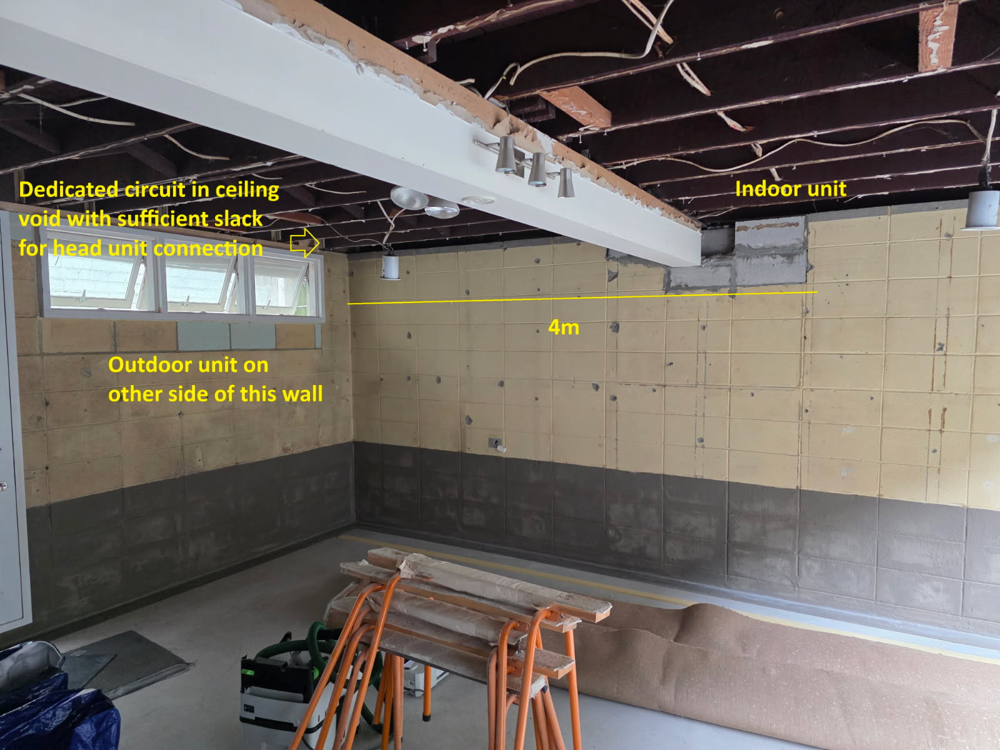
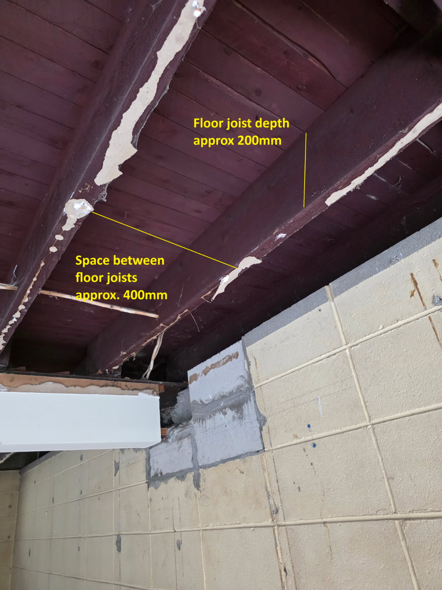
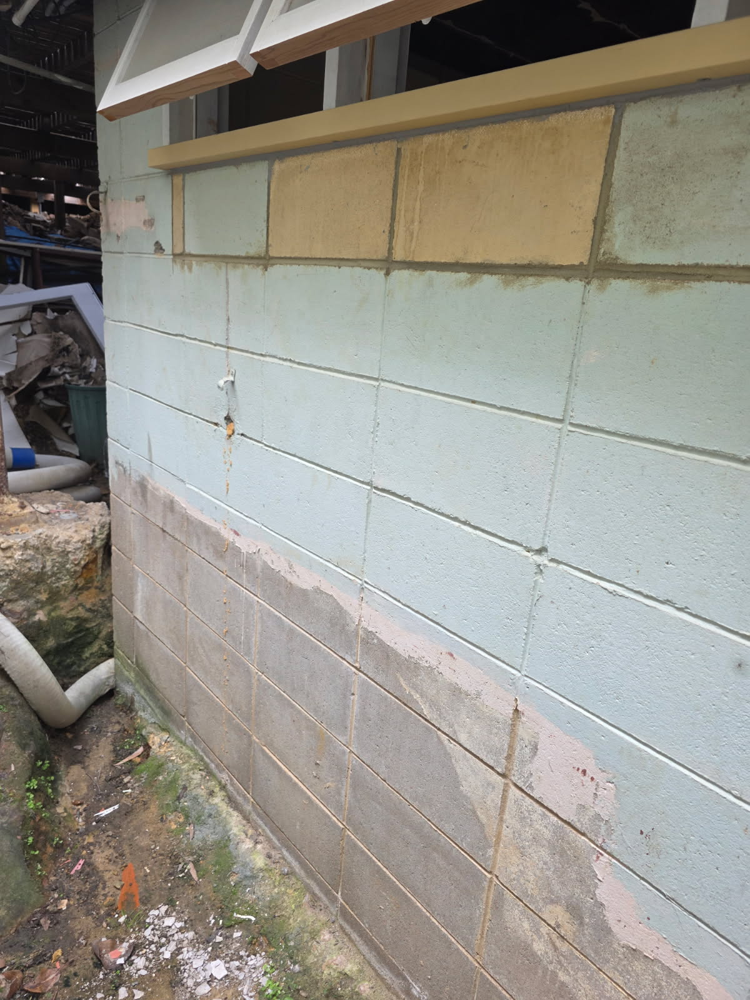

# 1 x 3.5 kW Mitsubishi Electric 1-way cassette: site assessment and scope of works

| Item | Detail |
|---|---|
| Indoor unit | MLZ-KP35VG-A1 (1-way ceiling cassette) |
| Outdoor unit | SUZ-M35VAD2-A (single phase, R32) |
| Grille panel | Ordered separately. Confirm the correct panel for the KP35VG with the supplier. |
| Controller | Wireless remote (check it's in the box). Wired controller is optional extra. |
| Site | Ground-floor room, ceiling currently stripped back to the joists |

> Specs marked **(verify)** are from memory. Check them against the MLZ-KP35VG and
> SUZ-M35VAD2 installation manuals before ordering or quoting.

## 1. What the photos show

- The indoor unit goes in the ceiling at the far end of the back wall, next to the patched block wall.
- The outdoor unit goes outside the left-hand wall, the one with the high-level windows.
- Pipe run along the back wall is about **4 m**. Adding the turn to the outside wall,
  the drop to the outdoor unit and the tails, budget **about 6–7 m** of pair coil.
- The client has already run a dedicated circuit into the ceiling void near the
  window wall, with slack left for the connection.

- Timber floor joists, **about 200 mm deep**, with **about 400 mm** between them.
  Floorboards sit directly on top, so the full void is about 200 mm.

- This is the outside face of the window wall, where the outdoor unit goes. It's painted
  concrete block, with the high-level windows and their timber sill above.
- At the base of the wall the ground is bare, uneven soil, with moss, a rock outcrop, debris
  and loose flexible conduit. It looks damp.
- There's an old fixing or pipe stub in the wall at about mid-height. Remove it or make it good.
- The internal corner is right next to the left end of the windows, so check the side clearance
  if the unit goes near the corner.

## 2. Key issue: cassette fit between the joists (decide before quoting)

The MLZ-KP35 body is roughly **1100 mm long × 360 mm wide × 185 mm high (verify)**.
The grille panel is larger.

| Check | Site | Unit | Result |
|---|---|---|---|
| Width between joists | ~400 mm clear | ~360 mm body, plus hanger brackets | **Tight.** Measure the true clear gap and the width across the brackets. |
| Depth of void | ~200 mm to underside of boards | ~185 mm body, plus room for hanging rods and nuts | **Too tight** if the ceiling goes straight onto the joists |
| Length | Along the joist bay | ~1100 mm | OK, as long as the unit runs parallel to the joists |

Options, in order of preference:

1. **Drop the ceiling line.** Fix battens or furring channel under the joists before the new
   plasterboard goes on. 35–50 mm of drop usually gives the depth the manual needs.
   This is the cheapest fix while the ceiling is open. Coordinate it with the builder.
2. **Local bulkhead.** Lower the ceiling only around the cassette and along the pipe route.
3. **Do not notch or cut joists** to make the unit fit unless a structural engineer has signed it off.

Mount the unit on M10 threaded rod (verify) fixed into the joist sides or to noggins
between the joists. Install it level, or with the slight fall towards the drain side
that the manual specifies.

## 3. Refrigerant pipework

- Pipe sizes: **1/4" liquid and 3/8" gas, flared (verify)**. Pre-insulated pair coil, about 7 m.
- Run inside the joist bay along the back wall. If the joists run parallel to that wall,
  no holes are needed. If the route crosses joists, bore holes on the joist centreline,
  no bigger than permitted. Don't notch the bottom edge.
- Core-drill the block wall for pipes, drain and interconnect. Sleeve the hole,
  fall it to the outside and seal it. It must sit below the new ceiling line but clear of
  the window head and lintel.
- Pre-charge covers runs up to about 7 m (verify), so no extra gas should be needed at about 6–7 m.
- Pressure test with nitrogen, evacuate to 500 microns or lower and do a decay test,
  then release the charge. Use R32-rated flare tooling and a torque wrench. Fit flare nuts as
  supplied, or as per the manual for R32.

## 4. Condensate drain

- Check whether the MLZ-KP has a built-in drain pump and what lift it gives **(verify)**.
- Preferred: gravity drain in 20–25 mm PVC, falling at least 1:100 inside the void,
  through the same wall penetration, to a gully or garden drain. Don't drain it onto a path.
- If gravity fall isn't possible within the void depth, use the internal pump.
  If there's no internal pump, allow for a mini condensate pump.
- Insulate the drain line inside the ceiling to stop sweating.

## 5. Electrical

- **Supply point:** the SUZ-M series is normally powered at the **outdoor unit**, with the indoor
  unit fed through the 4-core interconnect (S1/S2/S3 + earth) **(verify the wiring
  diagram)**. The new dedicated circuit in the ceiling void should therefore be extended
  through the wall to a **new weatherproof isolator next to the outdoor unit**, unless
  the manual allows separate indoor power.
- Breaker and cable: size them to the outdoor unit's MCA and maximum fuse (about 16 A / 2.5 mm²,
  **verify**). RCD protection is required. Check the switchboard has capacity.
- **Interconnect:** 4-core cable, 1.5 or 2.5 mm² as the manual specifies, about 7 m.
  Run it with the pipe bundle.
- Mount a new IP56 isolator on the block wall beside the outdoor unit, within sight of it.
  Run the power and interconnect cables through the same wall penetration as the pipes.
- The electrical work must be done by a licensed electrician, with a certificate of compliance or
  electrical safety certificate issued on completion.

## 6. Outdoor unit

- **Recommended: wall brackets** on the block wall below the windows, with the unit about
  400–500 mm above ground. This keeps it off the damp, uneven soil and away from debris
  and splash. A ground mount would need a proper concrete slab or a compacted, levelled base
  with a plastic pad. On soft soil like this, a pad alone will settle.
- **Fixings:** the blocks are probably hollow. Use chemical anchors with mesh sleeves, or
  fix into grouted cores, and allow for the full operating weight.
- **Pipe penetration:** the pipes leave the ceiling void at about window-head height.
  The two options are:
  1. Core-drill just beside the window frame at void level, then run the pipes down
     the outside wall in a UV-stable pipe duct to the unit. This is the neatest,
     and the inside stays hidden.
  2. Drop the pipes inside the room in a corner duct and penetrate below the window
     sill. This shortens the outside duct but leaves a visible duct indoors.

  Check the lintel position before drilling. Don't drill through the lintel or the window frame.
- **Clearances:** keep the manual's minimums (about 100 mm behind and to the sides, plus clear
  airflow in front). Check the clearance to the internal corner, and keep the discharge
  air from blowing back into the open awning windows.
- **Condensate:** the outdoor unit drains in heating mode. With a wall mount it will drip onto the
  soil. Direct it away from the footing, or fit the drain socket and hose it to a drain.
- **Site prep:** clear the debris and loose conduit from the area before the install.

## 7. Materials list

| # | Item | Qty |
|---|---|---|
| 1 | MLZ-KP35VG-A1 indoor unit | 1 |
| 2 | SUZ-M35VAD2-A outdoor unit | 1 |
| 3 | Grille panel for MLZ-KP35 | 1 |
| 4 | 1/4" + 3/8" insulated pair coil | 7 m |
| 5 | 4-core interconnect cable | 7 m |
| 6 | Outdoor isolator, IP56 | 1 |
| 7 | Power cable extension from ceiling circuit to the isolator | ~3 m |
| 8 | 20/25 mm PVC drain, fittings, insulation | 6 m |
| 9 | Condensate pump (only if no internal pump or fall) | 0–1 |
| 10 | M10 threaded rod, nuts, washers, noggin timber | 1 set |
| 11 | Wall brackets, anti-vibration mounts, chemical anchors and sleeves | 1 set |
| 12 | Core-drill wall sleeve, sealant, duct tape, wall cover plate | 1 set |
| 13 | UV-stable pipe duct down the outside wall, with bends and wall inlet | ~2.5 m |
| 14 | Outdoor unit drain socket and hose (heating condensate) | 1 |

## 8. Install sequence

1. Confirm the ceiling line and the drop option with the builder or client.
2. Mark the cassette position. Fit noggins and hanging rods. Hang and level the unit.
3. Core-drill the wall. Run the pipes, drain and interconnect in the void.
4. Mount the outdoor unit and isolator. Extend the power circuit.
5. Make the flares, pressure test, evacuate and release the charge.
6. Pour-test the drain. Check the pump runs, if fitted.
7. The ceiling is lined by others around the template. Fit the grille panel after painting.
8. Commission: check operating current, supply and return temperatures, and heat and cool mode.
   Hand over the remote and explain filter cleaning.
9. Register the warranty with Mitsubishi Electric.

## 9. Questions for the client

- Is the room size and use suitable for 3.5 kW? Do a quick heat load check if needed.
- Who is lining the ceiling? We need the unit hung and tested **before** the plasterboard goes on.
- Are wall brackets OK? We recommend them over a ground mount because of the soil and the damp.
- Is the client OK with a pipe duct on the outside wall, or do they prefer the pipes dropped inside?
- Who clears the debris beside the wall before install day?
- Where is the switchboard, and does it have spare capacity and RCD protection for the new circuit?
- Wireless remote, or a wired wall controller or Wi-Fi adapter?

## 10. Pricing (fill in)

| Item | Price |
|---|---|
| Equipment (indoor, outdoor, panel) | |
| Materials (section 7) | |
| Labour: AC install and commissioning | |
| Labour: electrical | |
| Optional: condensate pump | |
| Optional: ceiling drop or bulkhead framing | |
| **Total (excl. GST)** | |
